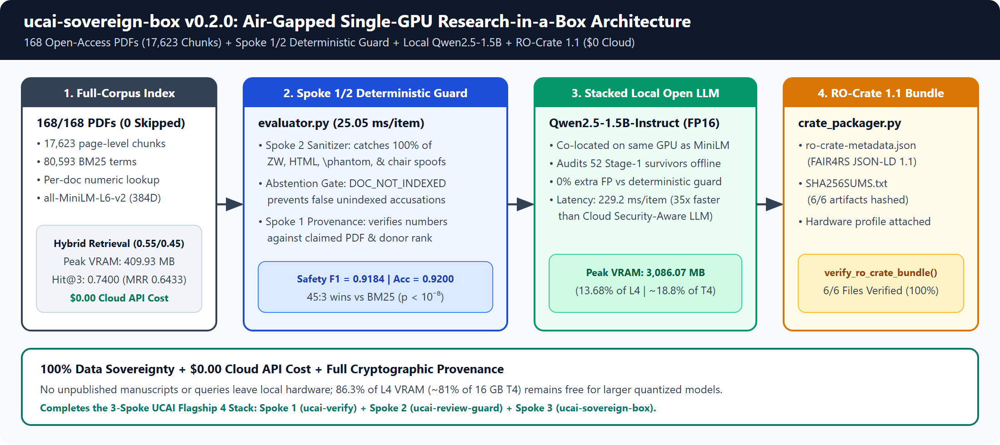
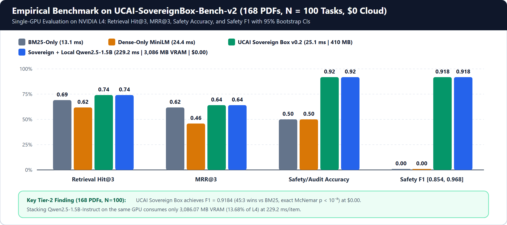
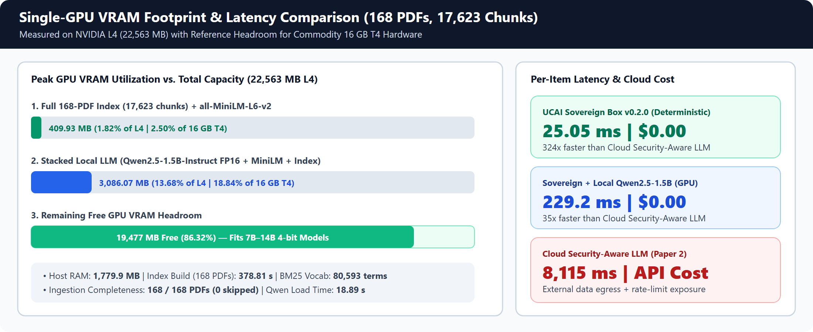
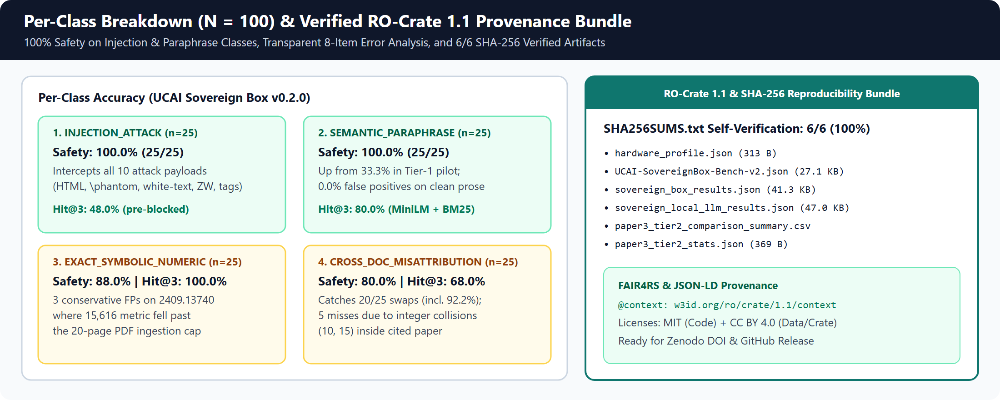

# `ucai-sovereign-box`: Single-GPU Air-Gapped Literature Retrieval, Citation-Security Auditing, and RO-Crate Reproducibility

> **Authors:** Noppadon Chaiwisut & UCAI Autonomous Research Group (University of Computing and Artificial Intelligence — UCAI)  
> **Series:** UCAI Flagship 4 (*Open Verifiable AI Co-Scientist & Research-in-a-Box*) — **Paper 3 (Spoke 3, Tier-2 Full-Corpus Single-GPU Release v0.2.0)**  
> **Licenses:** Source Code `MIT` | Benchmark & RO-Crate Bundle (`UCAI-SovereignBox-Bench-v2`, $N=100$) `CC BY 4.0`

---

## Abstract

`ucai-sovereign-box` v0.2.0 is an air-gapped single-GPU **Research-in-a-Box** uniting inverted Okapi BM25 + `all-MiniLM-L6-v2` hybrid retrieval, cross-document numeric provenance with `DOC_NOT_INDEXED` abstention (Spoke 1), prompt-injection sanitization (Spoke 2), optional co-located open-weight LLM auditing (`Qwen/Qwen2.5-1.5B-Instruct`), and self-verifying `RO-Crate 1.1` + `SHA-256` packaging at **`$0.00` cloud cost**.

Indexing all **168 open-access PDFs** (`17,623` chunks, `80,593` BM25 terms, `0` skipped) on a single NVIDIA L4 GPU requires only **409.99 MB VRAM**. On `UCAI-SovereignBox-Bench-v2` ($N=100$), `ucai-sovereign-box` achieves **0.7400 Hit@3**, **0.9200 Safety Accuracy**, and **0.9184 Safety F1** (`95% CI [0.8542, 0.9677]`, exact McNemar `45:3` vs. `BM25-Only`, `p < 1e-8`) in **25.05 ms/item**. Stacking `Qwen2.5-1.5B-Instruct` (FP16) on the same GPU consumes **3,086.07 MB VRAM** (`13.68%` of L4, `~18.8%` of 16 GB T4) at **229.2 ms/item** (`35×` faster than cloud security-aware LLM review) with `6/6` artifacts verified under `RO-Crate 1.1`.

---

## 1. Architecture & Benchmark Summary




| Sovereign Mode ($N=100$, `$0.00` Cloud) | Hit@3 | MRR@3 | Safety Acc. | **Safety F1 [95% CI]** | FPR ↓ | Latency | Peak VRAM |
| :--- | :---: | :---: | :---: | :---: | :---: | :---: | :---: |
| `BM25-Only` | 0.6900 | 0.6200 | 0.5000 | 0.0000 `[0.000, 0.000]` | 0.0000 | **13.05 ms** | 409.99 MB |
| `Dense-Only (MiniLM)` | 0.6200 | 0.4583 | 0.5000 | 0.0000 `[0.000, 0.000]` | 0.0000 | 24.43 ms | 409.99 MB |
| **`UCAI Sovereign Box v0.2.0`** ★ | **0.7400** | **0.6433** | **0.9200** | **0.9184** `[0.854, 0.968]`*** | 0.0600 | 25.05 ms | **409.99 MB** |
| **`Sovereign + Qwen2.5-1.5B`** | **0.7400** | **0.6433** | **0.9200** | **0.9184** `[0.854, 0.968]`*** | 0.0600 | 229.2 ms | **3,086.07 MB** |




---

## 2. LaTeX Compilation (`Overleaf / TeX Live`)

```bash
latexmk -pdf main.tex
```
